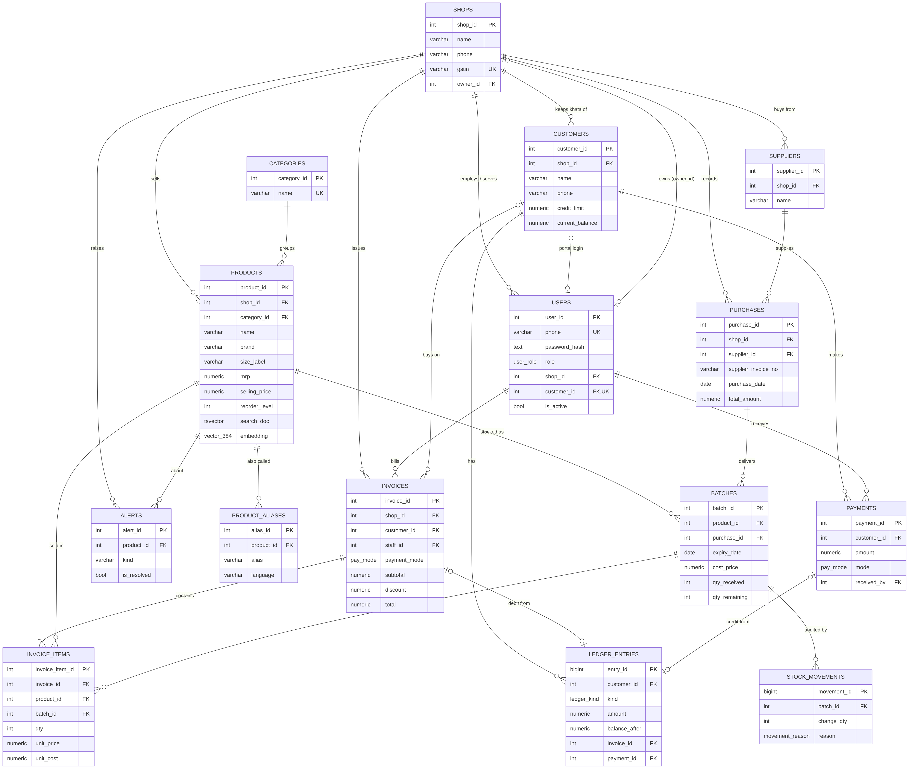
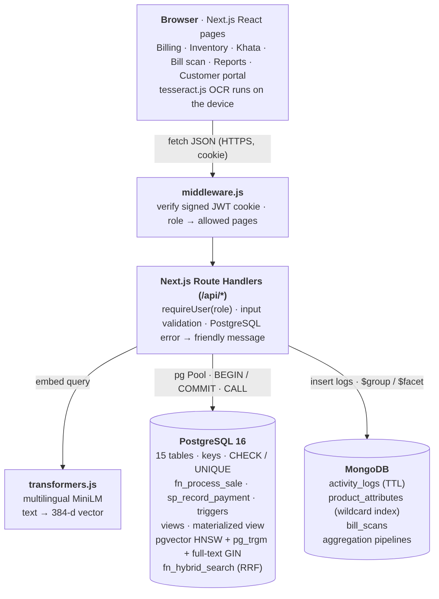

# Hisaab: Smart Ledger, Billing & Inventory for Kirana Stores

**DBMS Experiential Learning, Level 3 Project**
Department of Computer Science and Engineering, PES University

| | |
|---|---|
| **Student** | SHARVARI PES1UG24CS431|
| **Section** | H |
| **Database paradigms** | PostgreSQL 16 (relational) + pgvector (vector) + MongoDB 7 (document) |
| **Application** | Next.js 15 (App Router, Route Handlers as the API layer) |
| **Repository** | _https://github.com/your-username/hisaab_ |

---

## 1. Problem statement and objectives

India has over 12 million kirana (neighbourhood grocery) stores. Most still run on a paper notebook, the *khata*. The owner writes down every item a regular customer takes on credit (*udhaar*), remembers prices and stock in his head, and enters supplier bills by hand. This causes four recurring, costly problems:

1. **Credit leaks.** Nobody knows the exact balance, there is no limit, and customers who never repay keep getting credit.
2. **Expired stock.** Older stock sits behind newer stock until it expires and is thrown away.
3. **Slow billing.** Customers ask for items in Hindi, Kannada, Tamil or by brand nickname ("doodh", "paal", "Maggi"), and staff search by memory.
4. **Manual stock entry.** Every supplier bill has to be copied line by line.

**Objectives.** Build a multi-user web application that:

- bills quickly using search that understands local-language names, typos and meaning (hybrid full-text + fuzzy + vector search);
- keeps an **append-only credit ledger** with **database-enforced credit limits**;
- tracks stock **batch-wise with expiry**, sells **First-Expiry-First-Out (FEFO)**, and **cannot oversell**, even with two counters billing at once;
- turns a **photo of a supplier bill** into a stock-in entry by matching each line to the catalogue with vector similarity;
- scores customers' **credit risk** and forecasts **reorder quantities** using SQL window functions;
- gives four roles (Admin, Owner, Staff, Customer) exactly the access they need.

This is beyond CRUD: the core operations (billing, repayment, stock-in) are multi-table **transactions** whose rules live **inside the database** (functions, procedures, triggers, constraints), so they hold no matter which client calls them.

## 2. Functional requirements

| # | Requirement | Role |
|---|---|---|
| FR1 | Log in with mobile number + password; session in an HTTP-only signed cookie | All |
| FR2 | Search products by name, brand, alias in any language, with typos, while typing | Owner, Staff |
| FR3 | Create a bill (cash / UPI / udhaar) atomically: stock is decremented FEFO, prices come from the DB | Owner, Staff |
| FR4 | Refuse a credit sale that would cross the customer's credit limit | System (trigger) |
| FR5 | Suggest in-stock substitutes when an item is out of stock | Owner, Staff |
| FR6 | Record repayments; refuse over-payment; ledger is append-only | Owner, Staff |
| FR7 | Stock-in from a supplier bill: one purchase, one batch per line, in one transaction | Owner, Staff |
| FR8 | OCR a bill photo, match each line to a product, pre-fill the stock-in form | Owner |
| FR9 | Show stock, expiring batches (with discount suggestion), alerts and the stock-movement audit log | Owner, Staff |
| FR10 | Write off expired stock with an audit trail | Owner |
| FR11 | Manage products (price ≤ MRP, aliases, flexible attributes) and recompute embeddings | Owner |
| FR12 | Customer khata: statement, monthly trend, risk score, credit limit, WhatsApp reminder link | Owner |
| FR13 | Reports: KPIs, 14-day sales, top products, category revenue, staff, reorder list, monthly P&L, busy-hour heatmap | Owner |
| FR14 | Manage staff accounts (add, disable, reset password) | Owner |
| FR15 | Customer portal: own balance, statement and bills only | Customer |
| FR16 | Onboard a new shop and its owner | Admin |

## 3. Database choice and justification

The brief requires every database to be justified by **the nature of the data**, not added for show. Each kind of data in Hisaab went where its access pattern fits best.

| Data | Store | Why this store |
|---|---|---|
| Money: invoices, ledger, payments, credit limits | **PostgreSQL** | A wrong balance is real money lost. This data needs ACID transactions, foreign keys, CHECK constraints, row locks and triggers. Relationships (customer → invoice → items → batch) are fixed and joined constantly. |
| Stock: products, batches, purchases, movements | **PostgreSQL** | Selling must lock batches and decrement them atomically with the invoice. That only works if stock and sales live in the same transactional store. |
| Product meaning (embeddings) | **pgvector** inside PostgreSQL | "doodh", "milk" and "paal" share no characters, so keyword search cannot connect them. A multilingual embedding places them close together. Keeping vectors in the **same** database lets one SQL function fuse vector, full-text and fuzzy rankings and join the result with live stock, with no second round-trip and no sync problem. |
| Activity / audit log | **MongoDB** | Append-heavy, never updated, and every action type carries different fields (a sale has `total, mode, units`; a login has none). A TTL index expires old logs automatically. Aggregation pipelines (`$group`, `$facet`) produce analytics without touching the transactional database. |
| Product attributes | **MongoDB** | Attributes differ completely by product type: rice has *origin*, milk has *fat_pct*, noodles have *cooking_time_min*. In SQL this would be dozens of mostly-NULL columns or an EAV table. A document with a wildcard index stores and queries any key. |
| Scanned supplier bills | **MongoDB** | Raw OCR text plus a variable-length array of parsed lines and match results, whose shape differs per supplier. It is stored once and read as a whole. |

**Why not put everything in MongoDB?** Billing changes four collections at once (invoice, items, batches, ledger) and must enforce a credit limit across concurrent requests. Doing that reliably needs multi-document transactions plus hand-written locking, whereas PostgreSQL gives row locks, constraints and triggers natively.
**Why not put everything in PostgreSQL?** It would work, but the log would add write load and bloat to the OLTP tables, and the attributes would need a sparse or EAV design.

## 4. ER diagram



*(Source: `docs/er-diagram.mmd`, Mermaid.)*

**Key relationships and cardinalities**

- A **shop** has many users, customers, products, suppliers, purchases and invoices (1 : N). A shop has **one owner**: `shops.owner_id → users` (1 : 1, circular with `users.shop_id`, added later with `ALTER TABLE`).
- A **product** has many **batches**. Each batch has its own cost and expiry, which is what enables FEFO and profit per sale.
- An **invoice** has many **invoice_items**. Each item references the exact **batch** it was taken from, so an invoice ↔ batch relationship is M : N, resolved by `invoice_items`.
- **Ledger entries** are a weak-entity-like history of a customer. Each entry comes from exactly one invoice (debit) **or** one payment (credit), enforced by `chk_ledger_source`.
- A **customer** may have at most one portal **user** (`users.customer_id UNIQUE`, 1 : 0..1).
- **Product ↔ alias** is 1 : N (a multi-valued attribute normalised into its own table).

## 5. Relational schema

Primary keys are **bold**; foreign keys are marked `→`.

```
shops(**shop_id**, name, address, phone, gstin UNIQUE, owner_id → users, created_at)
users(**user_id**, name, phone UNIQUE, password_hash, role, shop_id → shops, customer_id → customers UNIQUE, is_active, created_at)
customers(**customer_id**, shop_id → shops, name, phone, address, credit_limit, current_balance, created_at)   UNIQUE(shop_id, phone)
categories(**category_id**, name UNIQUE)
products(**product_id**, shop_id → shops, category_id → categories, name, brand, size_label, unit, mrp, selling_price,
         reorder_level, is_active, search_doc, embedding, created_at)                              UNIQUE(shop_id, name, size_label)
product_aliases(**alias_id**, product_id → products, alias, language)                               UNIQUE(product_id, lower(alias))
suppliers(**supplier_id**, shop_id → shops, name, phone)                                            UNIQUE(shop_id, name)
purchases(**purchase_id**, shop_id → shops, supplier_id → suppliers, supplier_invoice_no, purchase_date, total_amount,
          created_by → users, created_at)                                                           UNIQUE(supplier_id, supplier_invoice_no)
batches(**batch_id**, product_id → products, purchase_id → purchases, batch_no, mfg_date, expiry_date, cost_price,
        qty_received, qty_remaining, received_at)
invoices(**invoice_id**, shop_id → shops, customer_id → customers, staff_id → users, payment_mode, subtotal, discount, total, created_at)
invoice_items(**invoice_item_id**, invoice_id → invoices, product_id → products, batch_id → batches, qty, unit_price, unit_cost,
              line_total GENERATED)
payments(**payment_id**, shop_id → shops, customer_id → customers, amount, mode, received_by → users, note, created_at)
ledger_entries(**entry_id**, customer_id → customers, kind, amount, balance_after, invoice_id → invoices, payment_id → payments, note, created_at)
stock_movements(**movement_id**, batch_id → batches, change_qty, reason, ref_id, created_by → users, created_at)
alerts(**alert_id**, shop_id → shops, product_id → products, kind, message, is_resolved, created_at)
```

### 5.1 Normalisation: from the paper khata to BCNF

A real khata page looks like this (one row per line written in the notebook):

| Date | Customer | Phone | Items taken | Amount | Paid | Balance |
|---|---|---|---|---|---|---|
| 12 Oct | Ramesh | 98450… | Milk 2, Bread 1, Maggi 3 | 141 | | 705 |
| 14 Oct | Ramesh | 98450… | | | 300 | 405 |

- **UNF → 1NF.** "Items taken" is a repeating group. Split it into one row per item: `(date, customer, phone, product, qty, price, amount, paid, balance)`.
- **Functional dependencies** found:
  `phone → customer_name, credit_limit` ·
  `product → price, mrp, category` ·
  `(bill_no, product, batch) → qty` ·
  `bill_no → date, customer, staff, mode` ·
  `batch → product, expiry, cost`.
- **1NF → 2NF.** With key `(bill_no, product, batch)`, attributes such as `date` and `customer` depend on `bill_no` alone (a partial dependency). Move them to **invoices**, leaving **invoice_items(invoice_id, product_id, batch_id, qty, …)**.
- **2NF → 3NF.** `invoice → customer → customer_name, credit_limit` is a transitive dependency. Move those attributes to **customers**. Likewise `batch → product → price` puts product data in **products**, and `product → category_name` puts category data in **categories**.
- **BCNF.** In every table, every determinant is a candidate key. For example in `customers`, `(shop_id, phone)` is also a key (UNIQUE), so `(shop_id, phone) → name` does not violate BCNF.
- **Deliberate, controlled redundancy.**
  - `customers.current_balance` (derivable from the ledger) and `ledger_entries.balance_after` are stored for O(1) reads, and are maintained **only** by the trigger `trg_ledger_apply` inside the same transaction, so they cannot drift.
  - `invoice_items.unit_price / unit_cost` are **historical snapshots**: prices change, but a past bill must not. This is a different fact, not redundancy.
  - `line_total` is a `GENERATED ALWAYS` column, so it can never disagree with `qty × unit_price`.

## 6. Data dictionary (main tables)

| Table.Column | Type | Constraint / meaning |
|---|---|---|
| shops.phone | VARCHAR(10) | CHECK `^[6-9][0-9]{9}$` (Indian mobile) |
| shops.gstin | VARCHAR(15) | UNIQUE, CHECK GSTIN format |
| users.role | user_role ENUM | admin / owner / staff / customer |
| users (row) | | `chk_user_scope`: admin has no shop; owner/staff have a shop; customer has a shop **and** a customer_id |
| customers.credit_limit | NUMERIC(10,2) | 0 … 1,00,000 |
| customers.current_balance | NUMERIC(12,2) | ≥ 0, written only by the ledger trigger |
| products.mrp / selling_price | NUMERIC(10,2) | > 0, `chk_price_not_above_mrp` (selling above MRP is illegal in India) |
| products.search_doc | TSVECTOR | name + aliases (weight A), brand (B), category (C); kept up to date by triggers |
| products.embedding | VECTOR(384) | multilingual sentence embedding; HNSW index, cosine |
| product_aliases.language | VARCHAR(5) | en / hi / ta / kn / te / other |
| batches.qty_remaining | INT | 0 ≤ qty_remaining ≤ qty_received |
| batches (row) | | `chk_dates`: expiry > mfg |
| purchases | | UNIQUE(supplier_id, supplier_invoice_no): the same bill can't be entered twice |
| invoices (row) | | credit ⇒ customer required; discount ≤ subtotal; total = subtotal − discount |
| invoice_items.line_total | NUMERIC(12,2) | GENERATED ALWAYS AS (qty × unit_price) STORED |
| payments.mode | pay_mode | CHECK ≠ 'credit' (a repayment is cash or UPI) |
| ledger_entries (row) | | debit ⇔ invoice_id, credit ⇔ payment_id; UPDATE/DELETE blocked by trigger |
| customers / payments / ledger FK | | ON DELETE RESTRICT: a customer with history cannot be deleted |

**Indexes**

| Index | Type | Serves |
|---|---|---|
| idx_batches_fefo | B-tree, **partial** (`qty_remaining > 0`) | FEFO picking in `fn_process_sale` |
| idx_products_search_doc | **GIN** on tsvector | full-text search |
| idx_products_name_trgm, idx_aliases_trgm | **GIN trigram** | fuzzy / typo matching |
| idx_products_embedding | **HNSW** (`vector_cosine_ops`) | nearest-neighbour search |
| uq_alias_per_product | **unique expression** index on `lower(alias)` | case-insensitive uniqueness |
| uq_open_alert | **partial unique** (`WHERE NOT is_resolved`) | at most one open alert per product + kind; enables `ON CONFLICT` |
| idx_customers_name_lower | expression index | customer search |
| idx_invoices_shop_date, idx_ledger_customer_date, … | composite B-tree | reports, statements |

## 7. Implementation

### 7.1 SQL (PostgreSQL), in the `sql/` folder

| File | Contents |
|---|---|
| `00_reset.sql` | `DROP … IF EXISTS … CASCADE` for every object |
| `01_schema.sql` | `CREATE TYPE`, `CREATE TABLE` with PK/FK/CHECK/UNIQUE, `ALTER TABLE` (circular owner FK), all indexes |
| `02_functions_triggers.sql` | 6 triggers, `fn_process_sale`, `sp_record_payment`, `sp_write_off_expired`, search functions |
| `03_views.sql` | 6 views, 1 materialized view + refresh procedure |
| `04_alter_drop_demo.sql` | `ALTER` (add/rename/retype columns, add `NOT VALID` constraint + `VALIDATE`), `DROP` (RESTRICT vs CASCADE) |
| `05_important_queries.sql` | 19 annotated queries grouped by syllabus unit |
| `seed.sql` | demo shop; 30 days of trading **simulated through the real functions** |

**Advanced features used (the brief asks for at least four SQL features and one NoSQL/vector feature):**

| Feature | Where |
|---|---|
| **Transactions** | `fn_process_sale` (invoice + items + stock + ledger as one unit); Node `withTransaction()` for stock-in and shop onboarding; automatic retry on deadlock / serialization failure |
| **Concurrency control / locking** | `SELECT … FOR UPDATE` on batches (no overselling) and on the customer row (no double credit); items processed in `product_id` order so locks are taken in a consistent order, which prevents deadlocks |
| **Stored functions** | `fn_process_sale`, `fn_hybrid_search`, `fn_similar_products`, `fn_prefix_tsquery`, `fn_build_search_doc` |
| **Stored procedures** | `sp_record_payment` (INOUT payment id), `sp_write_off_expired`, `sp_refresh_reports` |
| **Triggers** | credit-limit + balance (`ledger_apply`), immutable ledger, search-document maintenance (2), low-stock alerts with auto-resolve, purchase totals + stock-in audit |
| **Views** | `v_product_stock`, `v_expiring_soon`, `v_daily_sales`, `v_customer_risk`, `v_customer_monthly_trend`, `v_reorder_suggestions` |
| **Materialized view** | `mv_monthly_sales` with a unique index for `REFRESH … CONCURRENTLY` |
| **CTEs and window functions** | risk score (CTE chain, `RANK`, window `MIN … FILTER … OVER (ROWS BETWEEN 1 FOLLOWING …)`), monthly trend (`SUM OVER`, `LAG`), reorder forecast (moving `AVG … ROWS 13 PRECEDING`), recursive CTE stock-out projection |
| **Full-text search** | weighted `tsvector`, prefix `tsquery`, `ts_rank`, `ts_headline`, GIN index |
| **Vector similarity search** | pgvector `VECTOR(384)`, cosine distance `<=>`, HNSW index |
| **Indexing** | partial, expression, unique-partial, GIN, trigram, HNSW; `EXPLAIN ANALYZE` comparison in Q17 |
| **NoSQL aggregation** | MongoDB `$group` heatmap, `$facet` multi-report, `$cond` counters, TTL and wildcard indexes |

### 7.2 Hybrid search: how relevant products are retrieved

`fn_hybrid_search(shop, text, query_vector)` runs three retrievers and fuses them:

1. **Full-text**: a prefix `tsquery` (`'parle:* | biscuit:*'`) against the weighted `search_doc`, ranked by `ts_rank`.
2. **Fuzzy**: each typed word is compared with `word_similarity()` (pg_trgm) against name + brand + aliases, then averaged. This is how "magi noodels" finds Maggi.
3. **Semantic**: cosine distance between the query embedding and product embeddings (cut-off 0.65).

The three lists are merged with **Reciprocal Rank Fusion**: `score = Σ 1 / (60 + rank)`. RRF needs no score normalisation between incompatible scales (ts_rank vs similarity vs distance). A product found by several methods rises to the top, and the UI shows which methods matched (`text+fuzzy+semantic`).

### 7.3 Vector database details (as required by Section 8 of the brief)

| Question | Answer |
|---|---|
| **What is embedded?** | Each product as `name \| brand \| size \| category \| also called <aliases>`; each search query; each OCR'd supplier-bill line |
| **Model** | `paraphrase-multilingual-MiniLM-L12-v2` (Sentence-Transformers, 50+ languages), run locally with transformers.js (ONNX, 8-bit quantised). No paid API; the model downloads once (~120 MB) |
| **Storage** | `products.embedding VECTOR(384)` in PostgreSQL via pgvector, **HNSW** index with `vector_cosine_ops` |
| **Similarity metric** | Cosine distance (`<=>`). Vectors are L2-normalised, so ranking matches the dot product |
| **Retrieval** | Top-k nearest neighbours under a distance threshold, fused with full-text and trigram rankings (RRF), then joined with live stock in the same SQL statement |
| **Uses** | (a) billing search, (b) out-of-stock substitutes (`fn_similar_products`), (c) matching OCR bill lines to catalogue products |
| **Graceful degradation** | If the model is unavailable, the query vector is NULL and search falls back to text + fuzzy only. Nothing breaks |

### 7.4 MongoDB data model

```js
// activity_logs: one document per action, fields differ by action
{ shopId: 1, userId: 3, role: "staff", action: "sale.create", entity: "invoice", entityId: 412,
  meta: { total: 141, mode: "credit", lines: 3, units: 6, customerId: 1 }, at: ISODate(...) }
// indexes: {shopId:1, at:-1}, {shopId:1, action:1, at:-1}, TTL {at:1} expireAfterSeconds 31536000

// product_attributes: schema-less attributes per product
{ productId: 31, shopId: 1, attributes: { veg: true, cooking_time_min: 2, flavour: "masala" } }
// indexes: {productId:1} unique, wildcard {"attributes.$**": 1}

// bill_scans: raw OCR + parsed + matched lines
{ shopId: 1, source: "ocr", rawText: "...", status: "applied", purchaseId: 4,
  lines: [ { raw: "SURF XL EZY WSH 1KG 10 115.00 1150.00", item: "SURF XL EZY WSH 1KG", qty: 10, rate: 115,
             match: { productId: 40, name: "Easy Wash Detergent Powder", score: 0.0328, by: "text" } } ] }
```

Aggregations (in `lib/analytics.js`): a busy-hours heatmap (`$project $isoDayOfWeek/$hour` with the Asia/Kolkata timezone, then `$group`), and a `$facet` that returns counts by action, a staff leaderboard and a recent-activity feed in one round-trip. There is also a bill-scan match-rate summary.

## 8. Important queries

All queries are in `sql/05_important_queries.sql`. Run them with `npm run db:queries`.

| # | Query | Concepts |
|---|---|---|
| Q1 | Dairy products by price | selection, projection, join |
| Q2 | Categories with revenue > ₹5000 | GROUP BY, HAVING, aggregates |
| Q3 | Dead stock (not sold in 14 days) | LEFT JOIN … IS NULL |
| Q4 | Credit customers this week | nested subquery (IN) |
| Q5–Q6 | Biggest vs average bill; products above category average | correlated subqueries, EXISTS |
| Q7 | UPI-and-credit customers; credit-only customers | INTERSECT, EXCEPT, UNION ALL |
| Q8 | Walk-in vs named; unbranded products | NULL handling, COALESCE |
| Q9 | Top 3 per category | CTE + RANK() OVER (PARTITION BY) |
| Q10 | Running total, day-over-day change, 7-day moving average | SUM/LAG/AVG OVER |
| Q11 | Customer quartiles and share of sales | NTILE, ratio to total |
| Q12 | Days until stock-out | recursive CTE |
| Q13–Q14 | Full-text with highlighting; hybrid search | ts_rank, ts_headline, RRF |
| Q15 | Nearest neighbours of a product | vector `<=>` |
| Q16 | Risk ranking, reorder list, expiring stock, monthly P&L | views, materialized view |
| DML | INSERT / UPDATE / DELETE … RETURNING inside a rolled-back transaction | DML |
| Q17–Q18 | `EXPLAIN ANALYZE` with and without the partial index; GIN usage | query optimisation |
| Q19 | Live lock inspection (`pg_locks`) during the concurrency demo | locking |

**Example: credit risk score (view `v_customer_risk`, simplified)**

```sql
WITH flows AS (
  SELECT customer_id,
         SUM(amount) FILTER (WHERE kind='debit'  AND created_at >= now()-INTERVAL '90 days') AS borrowed_90d,
         SUM(amount) FILTER (WHERE kind='credit' AND created_at >= now()-INTERVAL '90 days') AS repaid_90d,
         MAX(created_at) FILTER (WHERE kind='credit') AS last_payment_at
  FROM ledger_entries GROUP BY customer_id)
SELECT c.name,
       40*LEAST(c.current_balance/c.credit_limit,1)
     + 30*LEAST(days_since_payment/60.0,1)
     + 30*(1-LEAST(repaid_90d/borrowed_90d,1))                      AS risk_score,
       RANK() OVER (PARTITION BY c.shop_id ORDER BY risk_score DESC) AS risk_rank
...
```

On the seeded data, the two customers who rarely repay come out on top (scores 98 and 96, band HIGH), and regular payers score below 20.

## 9. System architecture



- **Presentation:** Next.js React pages (client components), which talk only to `/api/*`.
- **Access control:** `middleware.js` verifies the signed JWT (HS256, `jose`) on every page request and redirects by role. Each API route calls `requireUser(request, [roles])` again (defence in depth). Passwords are hashed with bcrypt. The cookie is `httpOnly` and `sameSite=lax`.
- **API layer:** Next.js Route Handlers. Inputs are validated (`lib/validate.js`). Every SQL statement is **parameterised** (`$1, $2 …`), so there is no string concatenation and no SQL injection. PostgreSQL errors (`P0001` business rules, `23514` CHECK, `23505` UNIQUE, `40P01` deadlock …) are mapped to friendly messages.
- **Configuration:** `DATABASE_URL`, `MONGODB_URI`, `JWT_SECRET` and the model settings come from environment variables (`.env`, git-ignored; `.env.example` is committed). Nothing is hard-coded.
- **Data:** PostgreSQL (with pgvector and pg_trgm) and MongoDB, both started by `docker compose`.

**Role matrix**

| Capability | Admin | Owner | Staff | Customer |
|---|:-:|:-:|:-:|:-:|
| Onboard shops | ✓ | | | |
| Billing, stock-in, view inventory, record payment | | ✓ | ✓ | |
| Products, prices, credit limits, write-off | | ✓ | | |
| Reports (profit), risk scores, staff management, bill scan | | ✓ | | |
| Own balance, statement and bills | | | | ✓ |

## 10. Application screenshots

_Take these after running the app (`npm run dev`) and paste them here:_

1. Login page with demo accounts
2. Billing counter: search "doodh" showing `text` / `fuzzy` / `semantic` badges
3. Billing: out-of-stock product with substitute suggestions
4. Billing: credit sale refused with the "CREDIT_LIMIT_EXCEEDED" message
5. Inventory: stock tab, expiring-soon tab, stock movements
6. Bill scan: sample bill matched line by line
7. Udhaar khata list with risk badges; one customer's statement and monthly trend
8. Reports page: KPIs, 14-day chart, MongoDB heatmap, reorder list, monthly P&L
9. Customer portal (log in as 9845012345)
10. Admin: shops list
11. Two browser tabs selling the last packet at the same time: one succeeds, one gets "INSUFFICIENT_STOCK"

## 11. Testing

### 11.1 Database test suite (`tests/db_tests.sql`)

Run with `npm run db:test`. The suite runs inside one transaction and rolls back at the end. Actual output against PostgreSQL 16:

```
PASS  T01 FEFO: OLD batch emptied first
PASS  T02 invoice total computed from DB prices (7 x 27 = 189)
PASS  T03 stock movement audit rows written
PASS  T04 insufficient stock rejected: INSUFFICIENT_STOCK: Taaza Toned Milk (available 18, requested 500)
PASS  T05 atomic rollback: no invoice and soap stock untouched
PASS  T06 credit sale: balance 190 and ledger balance_after 190
PASS  T07 credit limit enforced
PASS  T08 rejected credit sale did not change balance or rice stock
PASS  T09 payment reduces balance to 90
PASS  T10 overpayment rejected
PASS  T11 ledger UPDATE blocked
PASS  T12 customer with history cannot be deleted (FK RESTRICT)
PASS  T13 selling price above MRP rejected
PASS  T14 invalid phone rejected
PASS  T15 credit sale without customer rejected
PASS  T16 discount larger than bill rejected
PASS  T17 same supplier bill entered twice rejected
PASS  T18 low-stock alert raised automatically
PASS  T19 purchase total = 360 and stock-in movement logged
PASS  T20 low-stock alert auto-resolved after restock
PASS  T21 expired batch written off (1 batch, 3 units)
PASS  T22 full-text search finds milk by Hindi alias "doodh"
PASS  T23 fuzzy search survives a typo ("lifeboy")
PASS  T24 prefix search while typing ("taa")
PASS  T25 v_product_stock: milk stock 18, expired 0 after write-off
PASS  T26 v_customer_risk returns a score for Ravi
PASS  T27 v_expiring_soon lists nothing for an emptied batch
Done. All test data rolled back.
```

**27 / 27 passed.**

### 11.2 Concurrency test (race for the last packet)

Two sessions call `fn_process_sale` for the **last unit** of a product at the same moment. Session A takes the row lock and commits after one second. Session B **waits** on the lock, re-reads the row after A commits, and fails cleanly:

```
cashier A: 8                                   <- invoice id, sale succeeded
cashier B: ERROR:  INSUFFICIENT_STOCK: Last Packet Maggi (available 0, requested 1)
remaining=0                                    <- never negative, never oversold
```

To reproduce in the app, open the billing page in two browser windows (log in as owner and as staff), add the same low-stock item, and click "Collect" in both.

### 11.3 Search quality (seeded catalogue, text + fuzzy only, before embeddings)

| Query | Top result | Matched by |
|---|---|---|
| `doodh` | Taaza Toned Milk | fuzzy + text (Hindi alias) |
| `thengai ennai` | Coconut Oil | fuzzy + text (Tamil alias) |
| `chawal` | Basmati Rice, Sona Masoori Rice | fuzzy + text |
| `lifeboy` (typo) | Lifebuoy Total Soap | fuzzy |
| `magi noodels` (typos) | Magic Masala Noodles, 2-Minute Masala Noodles | fuzzy (+ text for "magi:*" → Magic) |
| `colgat` | Strong Teeth Toothpaste | fuzzy + text |
| `SURF XL EZY WSH 1KG` (bill line) | Easy Wash Detergent Powder | text |

After `npm run db:embed`, purely semantic queries such as "something to wash clothes" or "snack for kids" also return the right products. The script prints these as a demo.

### 11.4 API-layer checks

- All 69 SQL statements embedded in the API code were compiled against the schema with `PREPARE` (catching any wrong table, column or type): 69 / 69 OK.
- The `CALL` statements were run through the extended query protocol (the same path node-postgres uses) and returned their `INOUT` values.

### 11.5 Manual test cases (UI)

| # | Steps | Expected | Result |
|---|---|---|---|
| M1 | Staff opens /reports | Redirected to /billing (owner-only page) | |
| M2 | Customer calls /api/sales/<someone else's bill> | 404 | |
| M3 | Credit sale for Suresh (owes ₹1900 of ₹2000) for ₹200 | Refused with limit message, cart kept | |
| M4 | Add product with price 60, MRP 50 | "Selling price cannot be higher than MRP." | |
| M5 | Enter the same supplier bill number twice | "This supplier bill number has already been entered." | |
| M6 | Pay ₹10,000 against a ₹500 balance | "OVERPAYMENT …" | |
| M7 | Bill scan with the sample bill → Save | 6 batches added; alerts for those products resolve | |
| M8 | Stop MongoDB, make a sale | Sale works; only logs/heatmap are skipped | |

_Fill in the Result column during your demo._

## 12. Conclusion

Hisaab shows that the hard parts of a small shop's business (money owed, stock that expires, two people billing at once) are exactly the problems that database features are built for. Putting the business rules **inside PostgreSQL** (constraints, triggers, a transactional sale function, row locking) means correctness does not depend on the web code being bug-free. Every client, test and script goes through the same rules. Using **pgvector in the same database** made multilingual, typo-tolerant search a single SQL function that joins directly with live stock. **MongoDB** took the data whose shape varies or that is write-heavy and analytical, keeping the transactional schema clean and normalised.

**Possible extensions:** UPI payment-link integration, SMS/WhatsApp Business API reminders, Redis for rate-limiting the login endpoint, a Neo4j "frequently bought together" graph, offline-first billing with sync, and GST invoice export.

## Appendix: how to run

See `README.md`. In short: `docker compose up -d` → `cp .env.example .env` → `npm install` → `npm run setup` → `npm run dev`.
